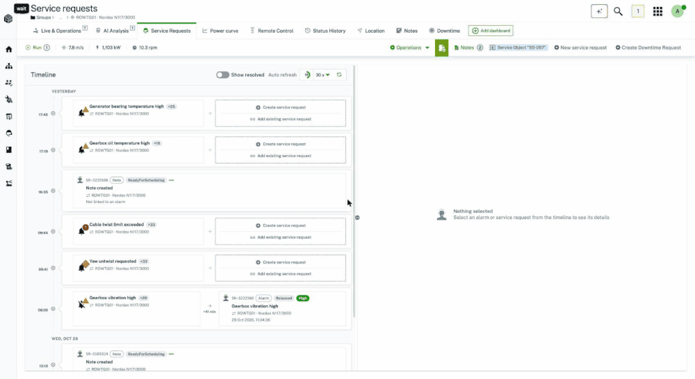
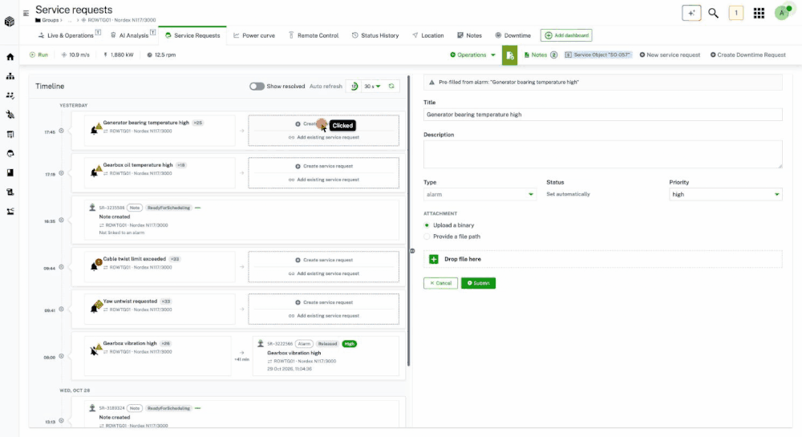
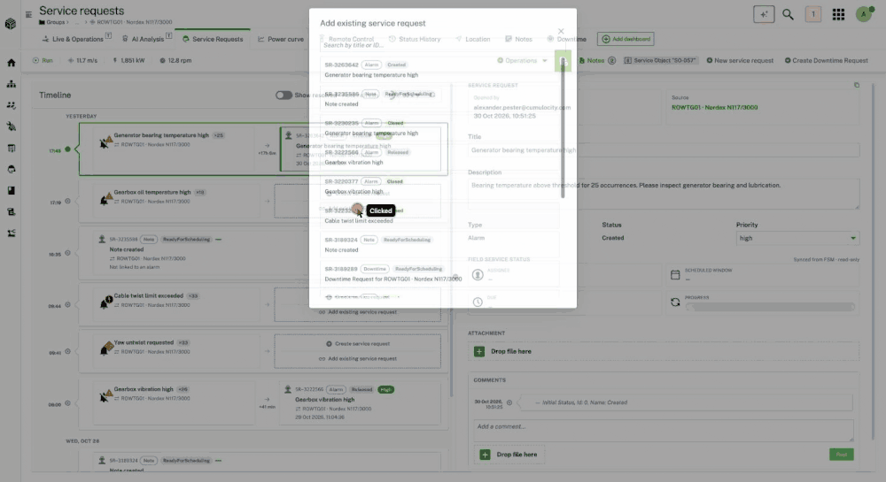
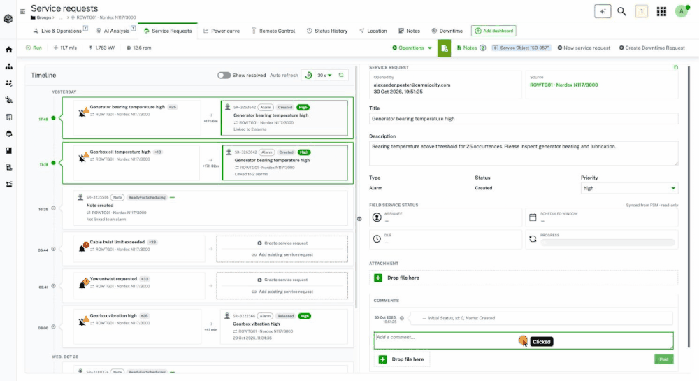
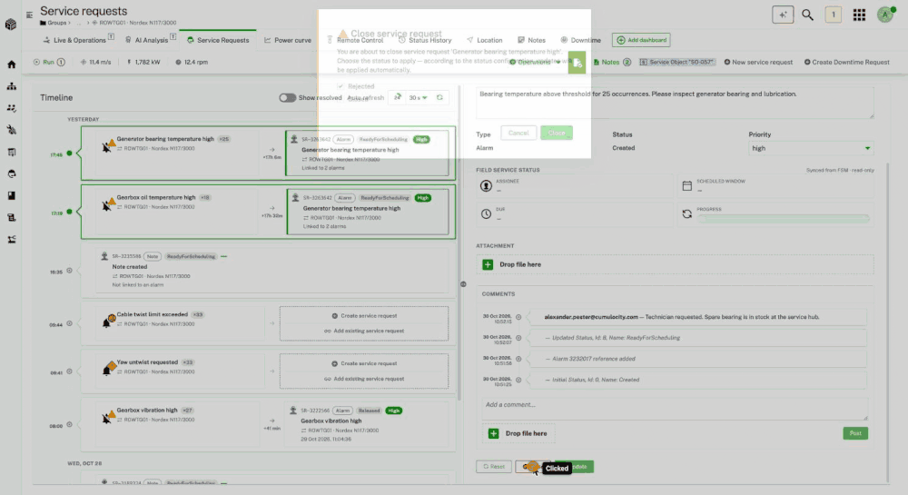
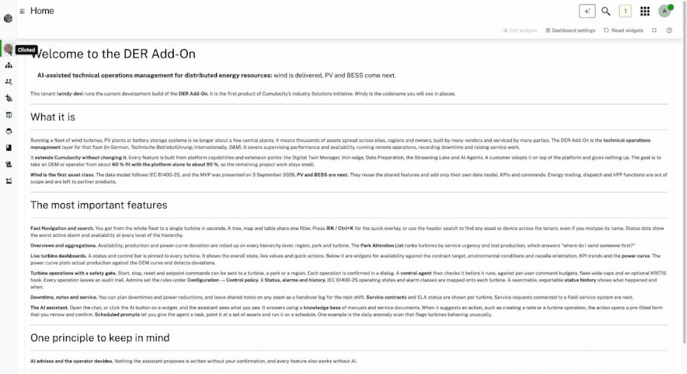

# Service Request plugin

The Service Request plugin adds service request management to Cumulocity applications such as Cockpit. Operators see alarms and service requests in one timeline, create a service request directly from an alarm, and follow its progress, including status updates synced from a field service management (FSM) system.



## Contents

- [Features](#features)
- [Requirements](#requirements)
- [Installation](#installation)
- [Development](#development)
- [Useful links](#useful-links)

## Features

### Combined timeline of alarms and service requests

The **Service Requests** tab lists alarms and service requests in a single timeline, newest first. Each service request appears next to the alarms it references, connected by an arrow. A service request that was created without an alarm appears as a standalone entry.

The tab uses a split view: the timeline fills the left column, and the details of the selected alarm or service request appear in the right column.

By default, the timeline shows only entries that still need attention. Turn on **Show resolved** to also show cleared alarms and closed service requests.

The tab is available on device, group, and asset pages. On group and asset pages, the timeline includes alarms and service requests of all child devices, and each row shows the name of its source device.

### Create a service request from an alarm



An alarm without a linked service request shows a dashed placeholder with two actions: **Create service request** and **Add existing service request**. **Create service request** opens the creation form in the detail panel with the alarm reference already filled in. Enter a title, description, type, and priority, and optionally add an attachment.

A service request has one of five types: Alarm, Note, Maintenance, Downtime, or Other. The type cannot be changed after creation.

To create a service request without an alarm, use **New service request** in the action bar.

### Link an existing service request to an alarm



One service request can reference several alarms, for example when one fault raises alarms on more than one sensor. **Add existing service request** opens a list of the service requests of the device, searchable by ID or title. Select one to link it to the alarm. The service request then appears next to each alarm it references.

### Service request details, comments, and attachments



Selecting a service request shows its details in four sections:

- **Service Request**: title, description, type, priority, status, and links to the referenced alarms
- **Field Service Status**: data synced from the FSM system, such as assignee, scheduled window, due date, progress, and FSM task (read-only)
- **Attachment**: one file per service request, added by drag and drop or the file picker
- **Comments**: a chronological list of user comments and system comments; system comments record changes such as status updates, and each comment can have one attachment

The copy icon in the panel header copies the complete service request object as JSON.

The status of a service request is read-only in the UI. It is set by the service-request-mgmt microservice and the FSM integration.

### Close a service request



In the standard process, the FSM system closes a service request. When the work order is completed in the FSM system, the FSM integration reports the closing status, and the service-request-mgmt microservice closes the service request automatically. This closed loop through the FSM system is the recommended way to close service requests.

Closing a service request manually in the UI is supported but is not part of the standard process. Use it only for exceptions, for example when a service request was created by mistake or is not handled in the FSM system.

**Close** lists the closing statuses configured for the tenant (statuses with `isClosedTransition: true`). After you select a status, the microservice closes the service request and applies the configured alarm status transition to the linked alarms, for example from ACTIVE to CLEARED.

### Tenant-wide view



The **Service Requests** entry in the left navigator opens the timeline for the whole tenant, limited by the read permissions of the user. Use the source selector to limit the timeline to one device, group, or asset.

## Requirements

The plugin requires the [service-request-mgmt microservice](https://github.com/Cumulocity-IoT/cumulocity-microservice-service-request-mgmt) on the tenant. The plugin uses its REST API, documented in the [Open API documentation](https://github.com/Cumulocity-IoT/cumulocity-microservice-service-request-mgmt/blob/develop/docs/README.md). If the microservice is not available, the **Service Requests** tab shows a message asking you to install it.

You can extend the microservice or replace it with your own. A custom microservice must implement the same REST API.

| Plugin version | Angular | Cumulocity Web SDK |
| -------------- | ------- | ------------------ |
| 2.x            | 21.x    | 1024.x             |

## Installation

1. Install the [service-request-mgmt microservice](https://github.com/Cumulocity-IoT/cumulocity-microservice-service-request-mgmt) on the tenant.
2. Download the plugin ZIP file from the [releases](https://github.com/Cumulocity-IoT/cumulocity-service-request-plugin/releases) page, or build it from source (see [Development](#development)).
3. Upload the plugin to the tenant and add it to an application such as Cockpit. The community article [How to install a Microfrontend Plugin on a tenant and use it in an app?](https://community.cumulocity.com/t/how-to-install-a-microfrontend-plugin-on-a-tenant-and-use-it-in-an-app/3034) describes each step.

## Development

### Recommended versions

- Node.js ^20.19.0, ^22.12.0, or >=24.0.0
- npm 11.x

### Run locally

The plugin runs as a Module Federation `remote` inside a `shell` application such as Cockpit. The shell application on the tenant must have at least the Web SDK version of the plugin (1024.x). If the tenant runs an older version, use `c8ycli` to create a Cockpit clone with version 1024.x or later, upload it to the tenant (for example as `cockpit-1024`), and use that name as the shell.

Start the plugin against a tenant:

```sh
npx ng serve -u https://<tenant>.cumulocity.com --shell cockpit
```

Alternatively, set `C8Y_BASEURL` and `C8Y_SHELL_TARGET` in your environment and run:

```sh
npm start
```

The `--shell` flag creates a proxy to the shell application and loads `ServiceRequestPluginModule` as a remote module.

### Build and deploy

```sh
npm run build
npm run deploy
```

Before you deploy, replace `{{C8Y_URL}}` in the `deploy` script in `package.json` with the URL of the target tenant. The application is uploaded as a plugin because it defines exports in `cumulocity.config.ts`.

### Tests

```sh
npm test          # unit tests
npm run e2e:run   # Cypress end-to-end tests
```

### Further documentation

- [Specification](./docs/spec.md): functional requirements of the plugin
- [Architecture decision records](./docs/adr): design decisions such as the timeline relevance filter

## Useful links

📘 **Knowledge base:** tutorials and articles in the [Cumulocity Community knowledge base](https://community.cumulocity.com/c/knowledge-base/7)

💡 **Forum:** questions to the Cumulocity experts in the [forum](https://community.cumulocity.com/c/forum/5)

🚀 **Free trial:** a [free trial of Cumulocity](https://www.cumulocity.com/start-your-journey/free-trial/)

✍️ **Feedback:** report bugs as an issue in this repository; share ideas and feedback in [Feedback & Ideas](https://community.cumulocity.com/c/feedback-ideas/14)

More articles:

- [How to install a Microfrontend Plugin on a tenant and use it in an app?](https://community.cumulocity.com/t/how-to-install-a-microfrontend-plugin-on-a-tenant-and-use-it-in-an-app/3034)
- [Cumulocity IoT Web Development Tutorial - Part 1: Start your journey](https://community.cumulocity.com/t/cumulocity-iot-web-development-tutorial-part-1-start-your-journey/4124)
- [The power of micro frontends – How to dynamically extend Cumulocity IoT Frontends](https://community.cumulocity.com/t/the-power-of-micro-frontends-how-to-dynamically-extend-cumulocity-iot-frontends/2577)

## Disclaimer

These tools are provided as-is and without warranty or support. They do not constitute part of the Cumulocity product suite. Users are free to use, fork, and modify them, subject to the license agreement. While Cumulocity welcomes contributions, we cannot guarantee to include every contribution in the main project.
